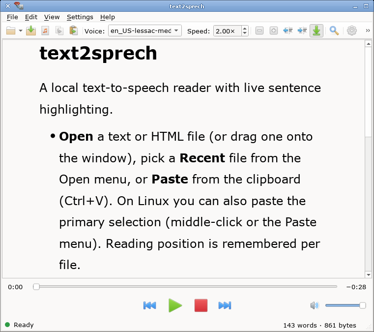

# text2sprech

Local text-to-speech reader: open or paste text or HTML, hear it read aloud
with **live sentence highlighting**, and control playback from the keyboard
or the player bar. Synthesis runs on your machine via [Piper](https://github.com/rhasspy/piper)
— nothing is sent to the cloud.



## Features

- Open `.txt` / `.html` files, paste from the clipboard (or primary selection
  on X11/Wayland), or pipe text on stdin
- Sentence-by-sentence playback with highlight, seek bar, previous/next
- Adjustable **voice** and **speed** (speed is applied in synthesis, not by
  pitching up the audio)
- **Find** in the document (synced with playback position)
- **Presentation mode** (fullscreen, larger type, high-contrast colors)
- **Export** the document (or from the current sentence onward) to a single WAV
- **Speak Clipboard** launcher: one click (or a desktop hotkey you bind) to
  read whatever is on the clipboard
- Preferences for fonts, colors, margins, and presentation defaults

## Requirements

- A desktop Linux system with Qt 6 (Widgets + Multimedia)
- **Voice models** for real audio: Piper `.onnx` + matching `.onnx.json` files
- Either a `piper` CLI on `PATH`, the Piper Python API, or the packaged
  `piper-server` wrapper from this project’s Nix flake

Without models, the app still starts and can exercise the UI using a silent
test backend (you will see a clear “no audio” warning).

### Installing voice models

Put voice files here (created on first launch if missing):

```
~/.local/share/text2sprech/voices/
```

Each voice needs a pair of files, for example:

```
en_US-lessac-medium.onnx
en_US-lessac-medium.onnx.json
```

Also scanned: `~/.local/share/piper/voices/`, directories listed under
**Preferences → Extra voice dirs**, and `$TEXT2SPRECH_PIPER_MODELS`.
Restart the app after adding models.

Official models are available from the
[piper-voices](https://huggingface.co/rhasspy/piper-voices) collection.

## Install and run

**From source (CMake + Qt 6):**

```bash
cmake -B build -G Ninja
cmake --build build
./build/text2sprech
```

**Nix:**

```bash
nix run .#text2sprech-full   # app + default en_US-lessac-medium voice
# or
nix develop                  # then cmake build as above
```

After `cmake --install` (or a distro/Nix package), the app appears in the
application menu. A second entry, **Speak Clipboard**, runs:

```bash
text2sprech --paste-clipboard --autoplay
```

Bind that command in your desktop’s keyboard settings if you want a global
hotkey (desktop files cannot register system-wide shortcuts by themselves).

The app starts and stops its own Piper server process automatically. Multiple
instances can run at once (each uses a unique socket).

## Everyday use

| Action | How |
|--------|-----|
| Play / pause | **Space** (works even if focus is on the speed control) |
| Previous / next sentence | **Left** / **Right**, or the transport buttons |
| Jump to a sentence | Click it in the document |
| Seek in the document | Drag the progress bar |
| Find | **Ctrl+F** |
| Paste clipboard | **Ctrl+V** or the toolbar button |
| Paste selection (X11) | Middle-click or **Paste Selection** |
| Presentation mode | **F11** / View menu; **Tab** toggles chrome; **Esc** exits |
| Auto-scroll | View → Auto-Scroll (follow the speaking sentence) |

**Preferences** (toolbar or Settings menu) edits *startup defaults* and can
preview them live. **Save** writes the config file; closing without Save keeps
only the session preview. Toolbar and CLI changes are session-only and do not
overwrite the config.

## Command-line options

```
text2sprech [options] [file]
```

| Option | Meaning |
|--------|---------|
| `--config` / `-c` *path* | Use this `.ini` for startup defaults (and Preferences Save) |
| `--voice` *name* | Initial voice (must be known to the server) |
| `--speed` *factor* | Initial speed, 0.5–5.0 (default 1.0) |
| `--font-family` *name* | Document font family |
| `--font-size` *pt* | Document font size, 6–200 |
| `--margin` *percent* | Extra horizontal margin each side (0–40) |
| `--line-spacing` *x* | Line height multiplier (e.g. 1.0, 1.5) |
| `--color-text`, `--color-background`, `--color-playing`, `--color-preparing`, `--color-stopped`, `--color-hover` | Session colors (`#RRGGBB` or `#AARRGGBB`) |
| `--autoplay` | Start speaking as soon as a document is loaded |
| `--paste-clipboard` | Load the clipboard on startup |
| `--paste-selection` | Load the primary selection on startup (X11/Wayland) |
| `--piper-socket` *path* | Connect to an existing server (app will not stop it) |
| *file* | Open this text/HTML file (`-` = stdin) |

Examples:

```bash
text2sprech --voice en_US-lessac-medium --speed 1.25 --autoplay book.txt
text2sprech --paste-clipboard --autoplay
cat chapter.txt | text2sprech --autoplay -
```

## Configuration file

Defaults live in a plain INI file (Linux):

```
~/.config/text2sprech/text2sprech.ini
```

Only the **Preferences** dialog writes this file. CLI flags and the toolbar
override it for the current run only.

```ini
[startup]
voice=en_US-lessac-medium
speed=1.25
fontFamily=Noto Sans
fontPointSize=13
extraMarginPercent=10
lineSpacing=1.0
# Optional colors (#AARRGGBB); omit for built-in light/dark defaults
# colorText=…
# colorBackground=…
# colorPlaying=…
# colorPreparing=…
# colorStopped=…
# colorHover=…

[presentation]
fontPointSize=28
extraMarginPercent=10
lineSpacing=1.5
# Optional teleprompter color overrides…

[voices]
extraDirs=/path/to/more/voices

[recent]
# managed by the app

[positions]
# per-file resume positions; managed by the app
```

## License

**GNU General Public License v3.0 or later** — see
[`LICENSES/GPL-3.0-or-later.txt`](LICENSES/GPL-3.0-or-later.txt).

## Developing

Build notes, architecture rules, protocol pointers, and agent workflow live in
[`AGENTS.md`](AGENTS.md). The client↔server wire format is documented in
[`PROTOCOL.md`](PROTOCOL.md).
